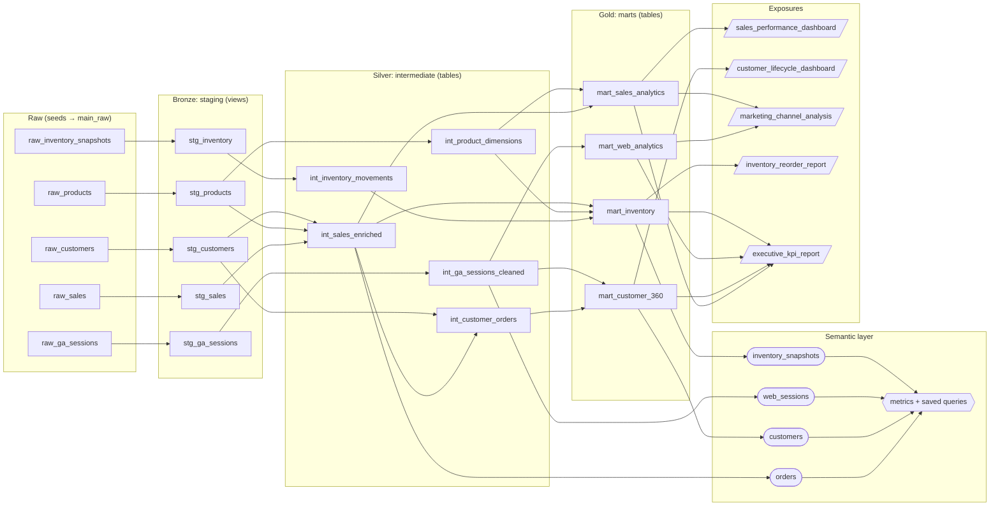

# Repo conventions

How this project is organized, how things are named, and how data flows from raw seeds to the metrics and dashboards people use. New here? Start with [Getting started](getting-started.md).

## How data flows

## Layers

| Layer | Folder | Prefix | Materialized | Schema | Job |
|---|---|---|---|---|---|
| Raw | `seeds/` | `raw_` | seed | `main_raw` | CSV extracts, loaded with `dbt seed`; read only through `source()` |
| Bronze | `models/bronze/` | `stg_` | view | `main_bronze` | One model per source table: rename, cast, convert units. No joins |
| Silver | `models/silver/` | `int_` | table (some incremental / ephemeral) | `main_silver` | Joins and business logic shared by several marts |
| Gold | `models/gold/` | `mart_` | table | `main_gold` | One model per use case, what dashboards and exposures read |
| Semantic | `models/semantic/` | none | n/a | n/a | Semantic models, metrics, saved queries, the time spine |

Layer defaults (materialization and schema) live in `dbt_project.yml`. Override them in a model's `config()` only with a reason, for example [int_sales_enriched](ref:int_sales_enriched) is incremental (`delete+insert` on `order_id`) and `int_product_dimensions` is ephemeral.

### Rules between layers

- **Only bronze reads sources.** Every raw table is read once, through `source('raw', …)`, by its staging model:
  - [raw_sales](source:raw.raw_sales) → [stg_sales](ref:stg_sales)
  - [raw_products](source:raw.raw_products) → [stg_products](ref:stg_products)
  - [raw_customers](source:raw.raw_customers) → [stg_customers](ref:stg_customers)
  - [raw_ga_sessions](source:raw.raw_ga_sessions) → [stg_ga_sessions](ref:stg_ga_sessions)
  - [raw_inventory_snapshots](source:raw.raw_inventory_snapshots) → [stg_inventory](ref:stg_inventory)
- **Refs only point down a layer or sideways.** Silver may ref bronze and other silver models; gold refs silver. Gold never refs bronze, and nothing refs gold except the semantic layer and exposures.
- **One home for each piece of logic.** If two marts need the same join, move it to silver. Example: [int_sales_enriched](ref:int_sales_enriched) joins sales to products and customers once; [mart_sales_analytics](ref:mart_sales_analytics), [mart_inventory](ref:mart_inventory) and [int_customer_orders](ref:int_customer_orders) all build on it.
- **Metrics are defined once, in the semantic layer.** Don't hand-compute revenue in a dashboard. Use [revenue](ref:revenue) or [average_order_value](ref:average_order_value). See [Semantic layer and metrics](how-to/semantic-layer-and-metrics.md).

## Naming

### Models and files

- `stg_<source table without raw_>`, `int_<entity>_<verb or detail>`, `mart_<subject>`.
- One model per file; the file name is the model name.
- YAML lives next to the SQL, one file per kind per folder, prefixed with `_` and the layer: `_bronze__sources.yml`, `_silver__models.yml`, `_gold__exposures.yml`, `_gold__unit_tests.yml`.

### Columns

| Pattern | Means | Example |
|---|---|---|
| `<entity>_id` | Primary or foreign key, `varchar` | `order_id`, `customer_id` |
| `<thing>_ts` | Timestamp, UTC | `order_ts`, `session_start_ts` |
| `<thing>_date` | Calendar date | `order_date`, `signup_date` |
| `<amount>_cents` | Integer money, raw data only | `unit_price_cents` |
| `<amount>_dollars` | Decimal money, from bronze on | `net_amount_dollars` |
| `is_<condition>` | Boolean | `is_active`, `is_below_reorder` |
| `<thing>_count`, `<thing>s` | Counts | `orders_count`, `page_views` |

Money arrives in cents and is converted once, in bronze, with the `cents_to_dollars` macro. Nothing downstream should see `_cents` columns.

### Glossary


The channel an order was placed through: **web** (desktop site), **mobile** (app), or **store** (point of sale in a physical store). Checked with an `accepted_values` test on [raw_sales](source:raw.raw_sales).


## Macros

Shared SQL lives in `macros/`, documented in `macros/_macros.yml`:

| Macro | Use it for | Used in |
|---|---|---|
| `cents_to_dollars(column, precision)` | Money conversion | [stg_sales](ref:stg_sales), [stg_products](ref:stg_products) |
| `normalize_email(column)` | Lowercase + trim emails | [stg_customers](ref:stg_customers) |
| `fiscal_quarter(date, start_month)` | Fiscal quarter labels (FY starts in February) | [int_sales_enriched](ref:int_sales_enriched) |
| `safe_divide(numerator, denominator)` | Ratios without divide-by-zero | [int_customer_orders](ref:int_customer_orders) |
| `generate_surrogate_key(columns)` | Hash keys from several columns | [int_inventory_movements](ref:int_inventory_movements) |

Prefer a macro (or `dbt_utils`) over copy-pasted SQL once something is used twice.

## Exposures

Every dashboard, notebook or report that reads a mart is declared in `models/gold/_gold__exposures.yml` with an owner, so impact analysis shows who a change affects:

| Exposure | Type | Reads | Owner |
|---|---|---|---|
| `sales_performance_dashboard` | dashboard | `mart_sales_analytics` | Sales Analytics |
| `customer_lifecycle_dashboard` | dashboard | `mart_customer_360` | CRM |
| `marketing_channel_analysis` | notebook | `mart_web_analytics`, `mart_sales_analytics` | Digital Marketing |
| `inventory_reorder_report` | ml | `mart_inventory` | Supply Chain |
| `executive_kpi_report` | dashboard | all four marts | Data Platform |

Adding a dashboard? Add its exposure in the same pull request.

## Pull requests

- [ ] New models have a description and a test on their primary key (see [Testing and data quality](testing-and-data-quality.md))
- [ ] `dbt build --select state:modified+` passes locally
- [ ] Changed marts: check the exposures and metrics downstream
- [ ] New metrics follow [Certifying a metric](how-to/semantic-layer-and-metrics.md#certifying-a-metric)
