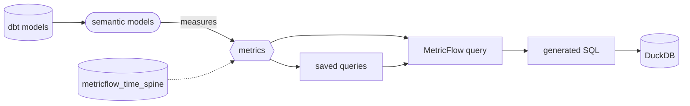

# Semantic layer and metrics

The semantic layer is where this project defines its business metrics: revenue, orders, conversion rate and so on. Each one is defined **once**, in YAML. Every dashboard, notebook and query then gets the same number, instead of each re-implementing "revenue" in its own SQL.

It's powered by **MetricFlow**, which reads the definitions and writes the SQL (joins, filters, time grains) for each request.

## How it fits together



### Semantic models

A semantic model sits on top of one dbt model and describes it in business terms. This project has four, in `models/semantic/_semantic__models.yml`:

| Semantic model | Built on | Grain |
|---|---|---|
| `orders` | [int_sales_enriched](ref:int_sales_enriched) | one row per order |
| `customers` | [mart_customer_360](ref:mart_customer_360) | one row per customer |
| [web_sessions](ref:web_sessions) | [int_ga_sessions_cleaned](ref:int_ga_sessions_cleaned) | one row per GA session |
| [inventory_snapshots](ref:inventory_snapshots) | [mart_inventory](ref:mart_inventory) | one row per store, product and snapshot date |

Each declares three kinds of things:

- **Entities**: the keys. `order` is the primary entity of `orders`; `customer` is a foreign entity there and the primary entity of `customers`. MetricFlow joins semantic models through shared entities, which is why you can slice revenue by `customer__loyalty_tier` without writing a join.
- **Dimensions**: what you group and filter by. Categorical (`channel`, `category`) or time (`order_date`). Each semantic model names an `agg_time_dimension`, the date its measures are counted on.
- **Measures**: aggregations of a column: `net_revenue` is `sum(net_amount_dollars)`, `buyers` is `count_distinct(customer_id)`. Inventory measures are *non-additive* across `snapshot_date`: stock on hand isn't summed across days, MetricFlow takes the latest snapshot in the period.

### Metrics

Metrics are what people actually ask for, defined in `models/semantic/_semantic__metrics.yml`. The types used here:

| Type | Means | Example |
|---|---|---|
| simple | One measure, optionally filtered | [revenue](ref:revenue) = `net_revenue`; [web_revenue](ref:web_revenue) adds `order__channel = 'web'` |
| ratio | One metric over another, each aggregated first | [average_order_value](ref:average_order_value) = revenue / orders; [conversion_rate](ref:conversion_rate) |
| derived | An expression over other metrics, including time offsets | [revenue_per_buyer](ref:revenue_per_buyer); [revenue_growth_wow](ref:revenue_growth_wow) compares with revenue 7 days earlier |
| cumulative | A running or to-date total | [cumulative_revenue](ref:cumulative_revenue); [revenue_mtd](ref:revenue_mtd) resets each month |

Ratios matter: average order value is `sum(revenue) / count(orders)` over the whole group. That's not the average of each day's AOV, and MetricFlow gets this right automatically.

Cumulative and offset metrics need the **time spine**, [metricflow_time_spine](ref:metricflow_time_spine): one row per day, so periods with no orders still show up.

### Saved queries

A saved query is a named, reusable request: metrics plus group-bys. This project has `weekly_revenue_by_channel`, `daily_web_funnel` and `revenue_by_loyalty_tier`. In dbt Cloud they can be **exported** as tables on a schedule (see below).

### `metric_time`

Every metric can be grouped by `metric_time`, which means "each metric's own time dimension". So `revenue` (counted on `order_date`) and `sessions` (on `session_date`) line up on one axis: `metric_time__week`, `metric_time__month`.

## Querying metrics locally

With dbt Core, use the MetricFlow CLI. It ships as `dbt-metricflow`; install it in a separate environment if its dbt-core pin clashes with yours. wickd does this for you in a sidecar environment.

```bash
pip install dbt-metricflow

mf validate-configs                      # check the YAML and run sample queries
mf list metrics                          # what's defined
mf list dimensions --metrics revenue     # what revenue can be sliced by

mf query --metrics revenue,orders,average_order_value \
         --group-by metric_time__week,order__channel \
         --order-by metric_time__week

mf query --metrics revenue --group-by customer__loyalty_tier \
         --where "{{ Dimension('order__category') }} = 'footwear'" --explain   # show the SQL only
```

In wickd: the **Metrics** page does the same with a one-line composer (`revenue by channel last 90 days`), shows MetricFlow's SQL, and saves any query as a saved query. Health → Semantic Layer runs the validations.

## Adding a metric

1. **Is there a measure for it?** If not, add one to the right semantic model (`agg` + `expr`).
2. **Add the metric** to `_semantic__metrics.yml` with a `name`, a human `label` and a `description` that says exactly what's in and out ("Net revenue after discounts, excluding refunds").
3. **Validate**: `dbt parse` then `mf validate-configs`.
4. **Check the number** against a plain SQL query on the underlying model for one known period.
5. Follow the certification checklist below if people will rely on it.

## Certifying a metric

dbt has no built-in "certified" switch on metrics, so certification is a team process. A certified metric is one the data team stands behind: business-facing dashboards may use it, and changes to it are reviewed. In this project a metric is certified when:

- [ ] It has a `label` and a `description` that defines it precisely (what's counted, what's excluded, which date it's on)
- [ ] It has an owner, through a dbt **group**, and is marked in `config.meta`:

  ```yaml
  groups:
    - name: sales_analytics
      owner:
        name: Sales Analytics Team
        email: sales-analytics@company.com

  metrics:
    - name: revenue
      label: Revenue
      description: Net revenue after discounts, by order date.
      group: sales_analytics
      config:
        meta:
          certified: true
          certified_by: sales-analytics
          certified_on: 2026-11-01
      type: simple
      type_params:
        measure: net_revenue
  ```

- [ ] The model under its semantic model is tested (primary key `unique` + `not_null`, contract where possible). See [Testing and data quality](../testing-and-data-quality.md)
- [ ] Its number was reconciled against an independent SQL query, and the query is noted in the PR
- [ ] Changing a certified metric's definition needs a review from its owner, and is called out in the PR title

Tools that read the manifest show `meta`: dbt Explorer in dbt Cloud shows it on the metric's page, and BI integrations can filter to `certified: true`. Uncertified metrics are fine for exploration; just don't put them on executive dashboards like `executive_kpi_report`.

## dbt Cloud: querying metrics from anywhere

Everything above works with open-source dbt Core: you define metrics and query them with the MetricFlow CLI, in your own environment. **dbt Cloud's Semantic Layer**, on paid plans, adds a hosted service that answers metric queries for other tools. You don't have to export tables or copy SQL into each tool. At the time of writing it requires a paid dbt Cloud plan (Starter/Team or Enterprise); check dbt's pricing page for current plans.

### What you get

| Feature | What it does |
|---|---|
| **JDBC API** (Arrow Flight SQL) | Any JDBC/ADBC client can query metrics with a SQL-like syntax |
| **GraphQL API** | Programmatic queries and metadata (list metrics, dimensions, run a query, fetch results) |
| **Python SDK** (`dbt-sl-sdk`) | Query metrics from Python / notebooks |
| **Integrations** | Native connections in BI tools such as Tableau, Power BI, Google Sheets, Excel, Hex, Mode and others; they list your metrics and dimensions and build the query for you |
| **Exports** | Saved queries written to the warehouse as tables or views on a job schedule, for tools that can only read tables |
| **Caching** | Repeated queries served from cache (result and declarative caching; Enterprise) |
| **dbt Explorer** | Browse metrics with their lineage, descriptions and metadata |

### Setting it up

1. Deploy the project in dbt Cloud: a **production deployment environment** and a job that runs successfully. The Semantic Layer serves whatever that environment last built.
2. In project settings, **configure the Semantic Layer**: warehouse credentials it queries with, and a **service token** (or personal access token) for API clients.
3. Note the **environment ID** and your account's Semantic Layer host (for example `semantic-layer.cloud.getdbt.com`, which differs by region).

### Querying

**JDBC.** Connect any Arrow Flight SQL client to

```
jdbc:arrow-flight-sql://semantic-layer.cloud.getdbt.com:443?&environmentId=<ENV_ID>&token=<SERVICE_TOKEN>
```

and query through the `semantic_layer` functions:

```sql
select *
from {{
  semantic_layer.query(
    metrics=['revenue', 'orders'],
    group_by=[Dimension('metric_time').grain('week'), Dimension('order__channel')],
    where=["{{ Dimension('order__category') }} = 'footwear'"],
    order_by=['metric_time__week']
  )
}}
```

Metadata works the same way, for example `select * from {{ semantic_layer.metrics() }}`.

**GraphQL.** Send requests to `https://<host>/api/graphql` with `Authorization: Bearer <token>`. You create a query, then poll for its results:

```graphql
mutation {
  createQuery(
    environmentId: <ENV_ID>
    metrics: [{ name: "revenue" }]
    groupBy: [{ name: "metric_time", grain: WEEK }]
  ) { queryId }
}
```

**Python:**

```python
from dbtsl import SemanticLayerClient

client = SemanticLayerClient(
    environment_id=123,
    auth_token="<SERVICE_TOKEN>",
    host="semantic-layer.cloud.getdbt.com",
)

with client.session():
    table = client.query(metrics=["revenue"], group_by=["metric_time__week"])
    print(table)  # a pyarrow Table
```

The exact syntax evolves; dbt's [Semantic Layer docs](https://docs.getdbt.com/docs/use-dbt-semantic-layer/dbt-sl) are the reference.

### Core vs Cloud at a glance

| | dbt Core + MetricFlow | dbt Cloud Semantic Layer |
|---|---|---|
| Define semantic models and metrics | ✅ | ✅ |
| Validate and query from the CLI | ✅ `mf` | ✅ `dbt sl` (dbt Cloud CLI) |
| See generated SQL | ✅ | ✅ |
| APIs for other tools (JDBC, GraphQL, Python) | — | ✅ |
| BI integrations | — | ✅ |
| Scheduled exports of saved queries | — | ✅ |
| Caching | — | ✅ (Enterprise) |

## Further reading

- [About MetricFlow](https://docs.getdbt.com/docs/build/about-metricflow)
- [Metrics overview](https://docs.getdbt.com/docs/build/metrics-overview)
- [Saved queries](https://docs.getdbt.com/docs/build/saved-queries)
- [Repo conventions](../conventions.md): where the semantic layer sits in the project's flow
